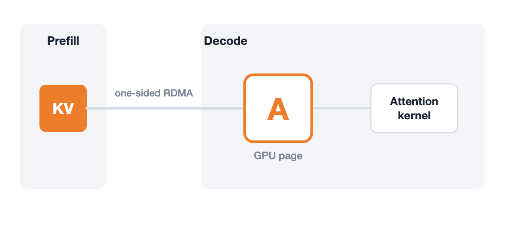

# veriserve: Verifiable LLM Serving Engine

`veriserve` is a verifiable LLM serving engine with Prefill-Decode disaggregation built on [`mini-sglang`](https://github.com/sgl-project/mini-sglang) and [Mooncake](https://github.com/kvcache-ai/Mooncake) GPUDirect RDMA with [`vstack`](https://github.com/yuxuandexter/vstack). It replaces scattered local counters and timeout heuristics with a single versioned KV page state machine, **`PdLedger`**, enforcing **Isolation**, **Integrity**, **Finality**, and **Conservation**.



## Quick Start

### 1. Run Disaggregated PD Serving

```bash
git clone https://github.com/yuxuandexter/veriserve.git
cd veriserve
python3 -m pip install -r tests/requirements.txt
export PYTHONPATH="$PWD/python"

# Fast CPU slice demo (<10s, no GPU required): test 1P1D scheduling, RDMA lifecycle, prefix cache, and fault injection
bash tests/run.sh

# Real GPU + Mooncake RDMA serving (1 Prefill instance + 1 Decode instance + PD Router)
CUDA_VISIBLE_DEVICES=0 python3 -m minisgl.server.launch \
  --model-path Qwen/Qwen3-0.6B --port 30000 \
  --disaggregation-mode prefill --disaggregation-bootstrap-port 8998 \
  --disaggregation-ib-device mlx5_0 --disaggregation-kv-checksum &

CUDA_VISIBLE_DEVICES=1 python3 -m minisgl.server.launch \
  --model-path Qwen/Qwen3-0.6B --port 30001 \
  --disaggregation-mode decode --disaggregation-ib-device mlx5_1 \
  --disaggregation-kv-checksum --disaggregation-stats-port 9100 &

python3 -m minisgl.disagg.router --port 8000 \
  --prefill http://127.0.0.1:30000 --prefill-bootstrap-port 8998 \
  --decode http://127.0.0.1:30001 &

curl http://127.0.0.1:8000/generate -H "Content-Type: application/json" \
  -d '{"prompt": "Formal verification of LLM serving ensures", "max_tokens": 64, "temperature": 0}'
curl http://127.0.0.1:9100/pd_stats   # inspect live PdLedger 5-state page and generation counters
```

### 2. Check the Formal Specification, Trace & Proofs

```bash
# Check the example runtime trace with the independent Python descriptor observer and test that
# corrupted observations are rejected and missing ones are reported as inconclusive (Python only,
# no TLA+). The optional TLC conformance
# check against the trace model is verification/pd-disagg/trace/check_rejected.py
# (see verification/pd-disagg/trace/README.md for its status)
python3 verification/pd-disagg/trace/check.py --out "$PWD/check-output"

# Run bounded TLC model checking on PdCore.tla (64 actions, 6 of which cannot occur under Design;
# the proof's inductive invariant has 54 conjuncts)
TLA2TOOLS_JAR=/path/to/tla2tools.jar python3 verification/pd-disagg/spec/check.py --out "$PWD/model-output"

# Check the packaged TLAPS proofs: static checks, one module, or a full parallel recheck
verification/pd-disagg/proofs/verify.sh --static
verification/pd-disagg/proofs/verify.sh --module PdABBQBase --out proof-review
# --slice-large requires the exact recorded toolchain build; with any other TLAPS build, use
# whole-module mode (--module, or --all --jobs 16 without --slice-large)
verification/pd-disagg/proofs/verify.sh --all --jobs 16 --slice-large --out proof-all
```

The TLAPS proof shows `Spec => []Safety` for the design model `PdCore`, under the
assumptions `Sizes` and `Design`. It is a safety theorem and contains no liveness
property. It does not prove that the Python implementation refines the model; the
implementation is linked to the model by runtime precondition checks, mutation tests
and trace checks. Some obligations are sensitive to machine load: rerun a failed module
alone with a larger `--stretch` before treating it as a proof failure. See
[`verification/pd-disagg/proofs/README.md`](verification/pd-disagg/proofs/README.md)
for the assumptions, results and known reproducibility issues.

## Architecture

In disaggregated Prefill-Decode serving, one-sided GPUDirect RDMA transfers, shared prefix caching, and Decode attention kernels operate concurrently on the same physical KV page pool. Because in-flight one-sided RDMA cannot be canceled in hardware, local CPU timeouts either risk silent cross-request overwrite if a page is reclaimed early, or hang the request if the page is held forever.

`PdLedger` resolves this by tracking every physical page with a versioned `(page, gen)` ticket across five explicit states (`FREE`, `PRIVATE`, `SHARED`, `DRAINING`, and `QUARANTINED`):

- **`Isolation`:** Active pages never jump straight back to `FREE`; canceled or evicted pages enter `DRAINING` first (`gen + 1` on reuse), while unstopped RDMA timeouts isolate in `QUARANTINED` so late RDMA writes never touch new requests.
- **`Integrity`:** Prefix-cache publish and Decode attention launch require verified `(page, gen)` ownership, completed transfer visibility, and checked GPU KV tensor byte offsets.
- **`Finality`:** Timed-out transfers without hardware stop evidence fail the waiting request immediately rather than hanging the Decode loop. This is runtime behavior; the proved theorem covers safety only and does not include this property.
- **`Conservation`:** Every physical page is accounted for across the five states. The proved property covers quiescence: with no active request and empty in-flight ledgers, each page is `FREE`, `QUARANTINED`, or an unreferenced `SHARED` page. Quarantined pages stay out of circulation by design.

---

*MIT License ([LICENSE](LICENSE)). Engine implementation: [`python/minisgl/disagg/`](python/minisgl/disagg/); formal `TLA+` specification: [`verification/pd-disagg/spec/PdCore.tla`](verification/pd-disagg/spec/PdCore.tla) ([`verification/pd-disagg/proofs/README.md`](verification/pd-disagg/proofs/README.md)); trace & mutation gates: [`verification/pd-disagg/trace/`](verification/pd-disagg/trace/README.md); upstream SGLang and vLLM bug analyses and impossibility proof: [`verification/pd-disagg/case-studies/`](verification/pd-disagg/case-studies/README.md). Built on [`mini-sglang`](https://github.com/sgl-project/mini-sglang).*
